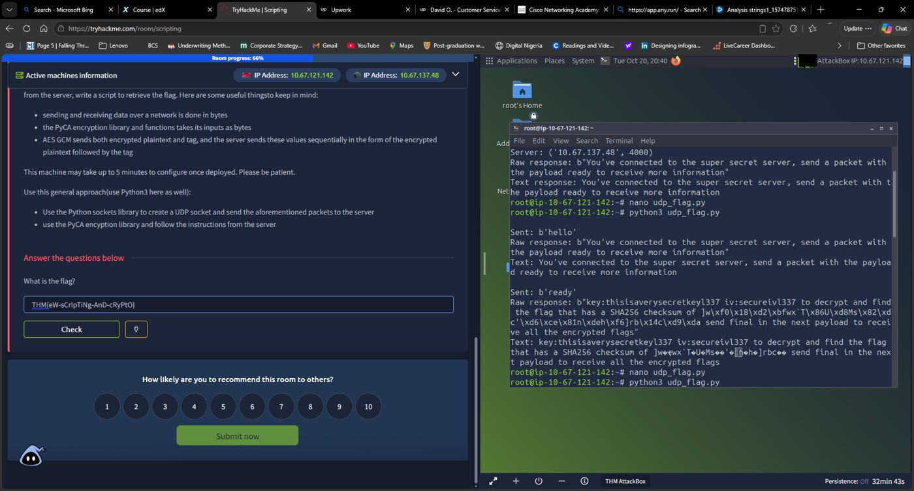
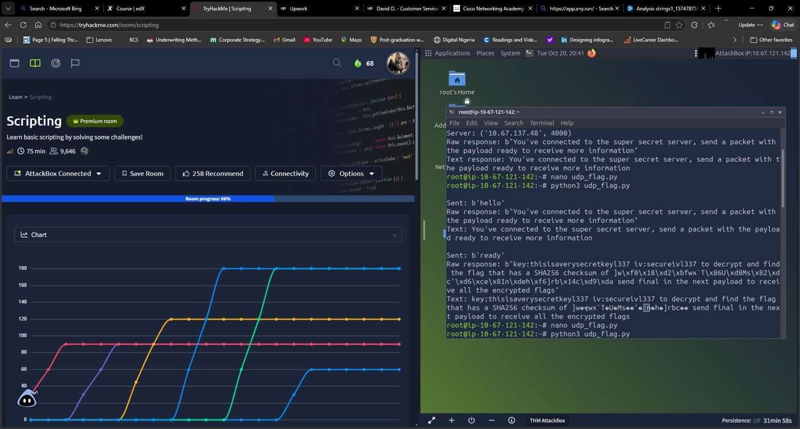

# TryHackMe — Scripting

**Author:** Timilehin Owolabi  
**Lab date:** 20 October 2026  
**Room:** https://tryhackme.com/room/scripting

This walkthrough documents three scripting exercises: repeated Base64 decoding, HTTP port hopping with arithmetic, and UDP communication with AES-GCM decryption. Work was performed against the assigned TryHackMe lab machines using the AttackBox and Python 3. Contains challenge answers.

## Results

| Exercise | Recovered answer | Evidence |
|---|---|---|
| Base64, 50 layers | `HackBack2019=` | Uploaded input decoded exactly 50 times |
| Port hopping | `344769.12` | Result returned by the learner's AttackBox script |
| UDP / AES-GCM | `THM{eW-sCrIpTiNg-AnD-cRyPtO}` | Authenticated decryption and matching SHA-256 |

The screenshots were taken during the session and show 66% room progress, not a final completion confirmation. Basic Malware RE was a separate room and is outside this write-up.

## Environment and files

Start the relevant lab machine and use an AttackBox or a machine connected to the TryHackMe VPN. Wait up to five minutes for the UDP task to configure. Each task can have a different IP; scripts accept the current IP as an argument instead of embedding an expired address.

```bash
sudo apt-get install python3-cryptography
```

Only the UDP script requires the extra package. The Base64 and HTTP scripts use the Python standard library. Download the Base64 input from the room; challenge source files are not redistributed here.

## 1. Decode Base64 fifty times

### Reasoning and steps

1. Read `b64_1550406728131.txt` as bytes.
2. Decode one Base64 layer.
3. Feed that result into the next iteration.
4. Repeat exactly 50 times, then convert the final bytes to text.

Base64 is an encoding, not encryption. Its trailing `=` can be meaningful in the final answer, so it must not be removed.

### Python

[Source: decode_base64.py](scripts/decode_base64.py)

```bash
python3 scripts/decode_base64.py b64_1550406728131.txt
```

### Bash

[Source: decode_base64.sh](scripts/decode_base64.sh)

```bash
bash scripts/decode_base64.sh b64_1550406728131.txt
```

The Bash implementation alternates temporary files instead of storing the approximately 33 MB initial input in a shell variable. A trap removes its temporary directory on exit.

**Output:** `HackBack2019=`

## 2. Follow HTTP ports and calculate a running total

### Reconnaissance

```bash
curl --max-time 5 http://MACHINE_IP:3010
```

The landing page explains the protocol and displays the currently active port. In this session it showed `40000`. That is the current point in the cycle, not the beginning: the calculation must start at `1337` with total `0`.

Each response supplies `operation number next_port`. For example:

```text
add 900 3212     -> total 900; next port 3212
minus 212 3499   -> total 688; next port 3499
```

### Implementation

[Source: port_hopping.py](scripts/port_hopping.py)

```bash
python3 scripts/port_hopping.py MACHINE_IP
```

1. Connect to TCP port 1337; retry until available.
2. Send an HTTP GET request using a socket.
3. Parse the HTTP response and extract the operation, operand, and next port.
4. Apply addition, subtraction, multiplication, or division.
5. Immediately follow the next port; each port is live for only four seconds.
6. Stop on `STOP` or when the next port is 9765.
7. Format only the final result to two decimal places.

`http.client.HTTPResponse` handles the HTTP headers and body over the existing socket. `Decimal` with 100-digit precision avoids premature two-decimal rounding. If the sequence is missed, stop and restart from 1337 with the total reset rather than combining different cycles. The retry loop can wait indefinitely; Ctrl+C stops it.

**Observed result:** `344769.12`

## 3. Retrieve a flag over UDP and decrypt with AES-GCM

### Handshake

Use one UDP socket throughout, preserving the client endpoint:

| Client payload | Server response |
|---|---|
| `hello` | Requests `ready` |
| `ready` | Supplies key, IV, and a raw 32-byte SHA-256 digest; requests `final` |
| `final` | Sends candidate ciphertexts and authentication tags |

Session parameters:

```text
Key: thisisaverysecretkeyl337
IV / nonce: secureivl337
SHA256: 5d77f018d2bf777860548655d84d7382dc27d6ce816ede68f65d72621463d9da
```

The key is 24 bytes (AES-192), and the nonce is 12 bytes. These are deliberately supplied lab values. The digest contains arbitrary bytes: decoding the entire response as UTF-8 with replacement corrupts them. Extract exactly 32 bytes after the marker `SHA256 checksum of ` from the original response.

### Packet handling and decryption

[Source: udp_aes_gcm.py](scripts/udp_aes_gcm.py)

```bash
python3 scripts/udp_aes_gcm.py MACHINE_IP
```

The decisive observation was that the server sends **two separate UDP datagrams per candidate**:

1. Ciphertext.
2. Its 16-byte GCM authentication tag.

PyCA's `AESGCM.decrypt` expects their concatenation:

```python
plaintext = aes.decrypt(nonce, ciphertext + tag, None)
```

`None` means no additional authenticated data is supplied for this lab. Authentication must succeed before using the plaintext. Hash each decrypted candidate with `hashlib.sha256(plaintext).digest()` and compare the raw digest to the supplied digest.

**Recovered flag:** `THM{eW-sCrIpTiNg-AnD-cRyPtO}`

Its SHA-256 is exactly the digest above. This was verified locally from the ciphertext/tag pair captured in the terminal output. The script assumes the lab's observed consecutive packet order. UDP does not guarantee delivery or ordering; if pairing/authentication fails, restart the handshake rather than accepting unauthenticated output.

## Troubleshooting notes

| Symptom | Cause / resolution |
|---|---|
| `socket.gaierror: Name or service not known` | The host value was not a resolvable address. Use the actual lab IP without `http://` or a port. These scripts take it as a command-line argument. |
| No UDP reply | Check the task IP, VPN/AttackBox connectivity, and deployment wait time. |
| Garbled checksum text | The checksum is binary, not a readable UTF-8 string. Preserve and slice raw bytes. |
| Every candidate fails authentication | The first implementation treated ciphertext and tag datagrams as complete encrypted messages individually. Receiving two packets and concatenating them fixed the format error. |
| `No module named cryptography` | Install `python3-cryptography` using the package manager. |
| Port sequence missed | Restart the script at 1337 with total 0; do not resume a partial total from another cycle. |

## Screenshots

### UDP handshake and candidate answer entry

The terminal shows `hello` and `ready` responses. The answer has been entered on the left; this image does not show an accepted-answer confirmation.



### Room overview during the session

The room overview shows the Scripting title and 66% progress at capture time.



## Lessons learned

- Automate repeated transformations with a loop and an explicit iteration count.
- Keep binary network data as bytes until a field is known to be text.
- Match the application protocol, including message order and packet boundaries.
- Verify AES-GCM tags and compare the requested SHA-256 digest, rather than selecting a plausible-looking flag.
- Treat exceptions as evidence: the authentication failures revealed a framing mistake.

## Validation and limits

The original uploaded Base64 input was decoded successfully earlier in the session. During packaging, the currently available copy was shorter (32,715,264 bytes versus the earlier 33,715,532 bytes) and failed at layer five. Both packaged decoders were therefore checked using a generated 50-layer fixture; use a fresh room download if the source file reports incorrect padding. The port-hopping result was reported from the AttackBox run. The AES-GCM flag was independently authenticated and hash-checked using the captured packet pair. Packaged scripts receive syntax checks and an offline crypto fixture check; they were not rerun against the live private lab from this workspace.

## References

- [Python socket documentation](https://docs.python.org/3/library/socket.html)
- [Python Base64 documentation](https://docs.python.org/3/library/base64.html)
- [PyCA AESGCM API](https://cryptography.io/en/latest/hazmat/primitives/aead/#cryptography.hazmat.primitives.ciphers.aead.AESGCM)
